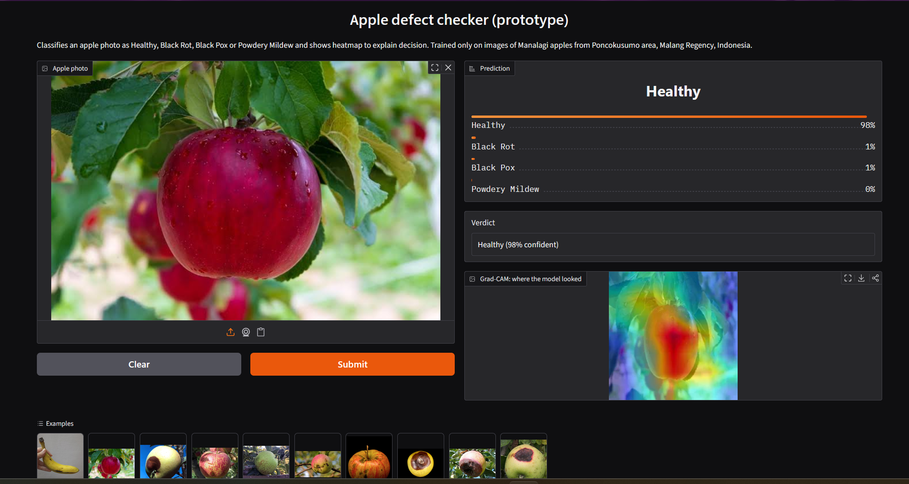
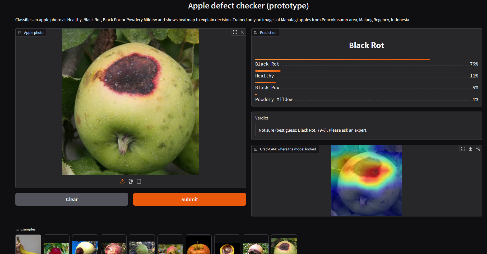

# Fruit Defect Classifier [Prototype]

A prototype that looks at a photo of an apple and returns the most likely condition (Healthy, Black Rot,
Black Pox or Powdery Mildew), a confidence, and a Grad-CAM heatmap showing where the model looked.
Below 80% confidence it says "not sure" and recommends asking an expert.

Course project for Soft Computing. 

## App Interface





## Results

| | Value |
|---|---|
| Model | ResNet18 pretrained on ImageNet, frozen backbone, new 4-class layer, and without augmentation |
| Data | 3,194 photos, 4 classes |
| Test accuracy | 95.4% (validation 94.6%) |
| Test macro-F1 | 0.948  |
| FNR | 2.9% of diseased test photos |
| With confidence threshold of 0.80 | 97.9% accuracy |


## Run the demo

```
cd demo_app
pip install -r requirements.txt
python app.py
```


## Method summary

- Transfer learning was used with an ImageNet-pretrained model, along with class-weighted cross-entropy loss. The model was trained for 10 epochs using a fixed random seed.
- The original dataset split sometimes placed almost identical photos of the same apple in both the training and testing sets. To avoid this, grouped similar images using file numbers, timestamps, and image-feature similarity, then created a new split with 70% training, 15% validation, and 15% testing data for each class.
- Tested different augmentation levels (none, light, and aggressive) and fine-tuning strategies (frozen, last block, and all layers). Since the differences between the frozen and fine-tuned models were small and within the range of experimental variation, we went with the simpler frozen model.

## Limitations

- One apple variety from one region only
- A few percent of evaluation photos still have a near-duplicate in training
- The model cannot identify objects that are not apples.
  
## Data/licence

FEBRIANTONO, ALDIKI (2025), “Apple Disease Dataset”, Mendeley Data, V1, doi: 10.17632/9zgkwwv9j8.1
